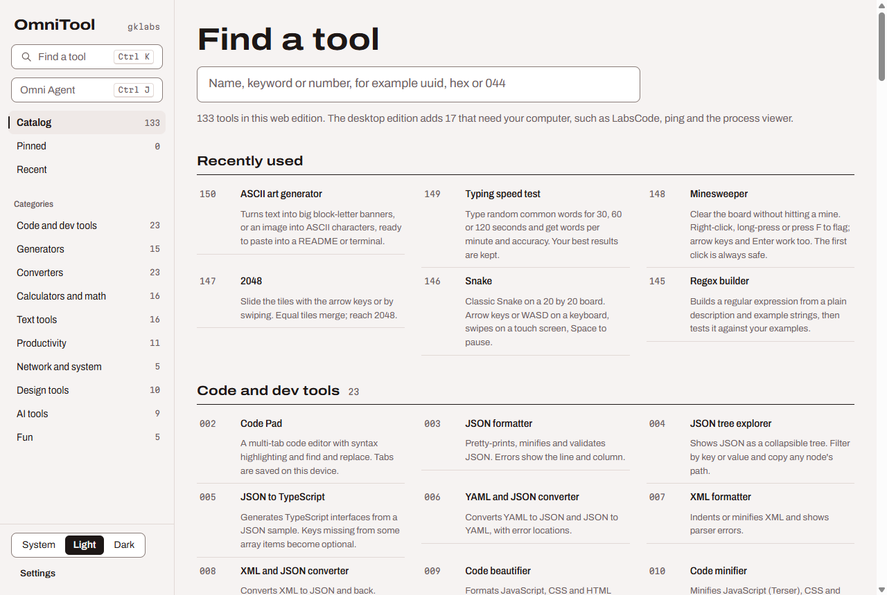
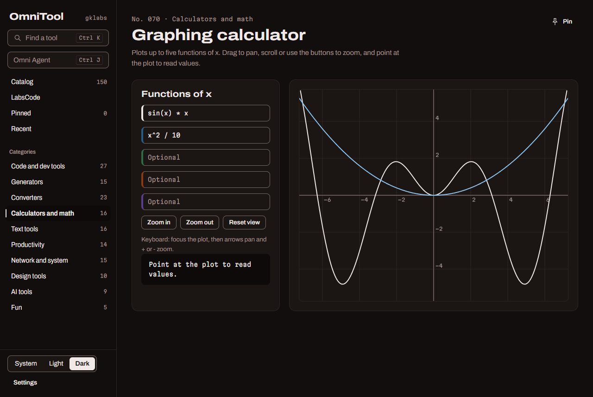
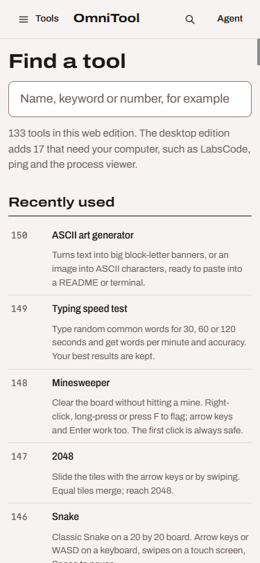
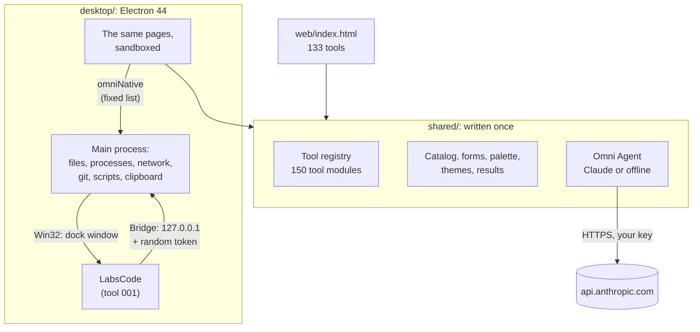
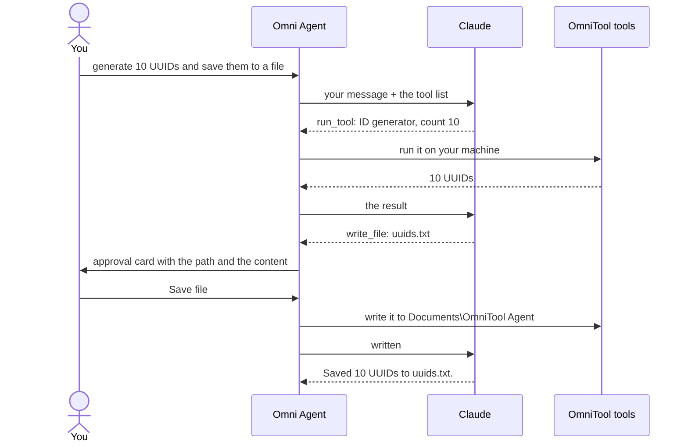

# OmniTool

**150 developer and everyday tools in one window**, with the full LabsCode editor built in and an AI assistant, Omni Agent, that can run the tools for you.

JSON, regex, hashes, unit and color conversion, a graphing calculator, a to-do list, ping and a process viewer, QR codes, a typing test: every tool has a catalog number from No. 001 to No. 150, and Ctrl+K finds any of them. Ask Omni Agent "generate 10 UUIDs and save them to a file" and it runs the ID generator, shows you the file and saves it only once you say yes.



| | Desktop edition | Web edition |
|---|---|---|
| Tools | All 150 | 133 (the [17 cut ones](FEATURES.md#web-edition-cuts) need your computer) |
| Runs on | Windows 10 or 11, 64-bit (x64) | Any recent browser, phones included |
| LabsCode | The real editor, docked in a tab | Code Pad, a lighter editor |
| Install | Double-click `desktop\start.bat` | Open `web/index.html`. No server, no build. |
| Omni Agent | Claude with your key, or offline mode | Same |

<p>
  
  
</p>

## Before you install

Read this first. The desktop edition downloads a full code editor and a browser runtime, and those take real space and memory.

### Desktop edition

| Requirement | Details |
|---|---|
| **Operating system** | Windows 10 or Windows 11, **64-bit on an x64 processor** (Intel or AMD). Windows on ARM, macOS and Linux are not supported for the desktop edition; use the web edition there. |
| **First-run download** | **About 580 MB**: LabsCode 384 MB, Electron 151 MB, Node.js 36 MB (skipped if Node.js 18 or newer is already installed), packages about 6 MB. Later starts download nothing. |
| **Disk space** | **Keep at least 2.5 GB free for the first run.** After setup OmniTool uses about 1.4 GB: LabsCode 769 MB, Electron and koffi 385 MB, download caches about 160 MB, Node.js 94 MB if it was downloaded. LabsCode's own data folder (settings, extensions, caches, logs) starts small and grows as you use it; after a day of testing it was about 300 MB. |
| **Memory** | **8 GB of RAM if you use the LabsCode tab, 4 GB without it.** Measured: OmniTool on its own used about 0.25 GB of private memory; LabsCode used about 1.3 GB right after it opened, with no folder open. |
| **Internet** | Needed for the first run (nodejs.org, the npm registry, github.com) and for the tools that call outside services (listed under [Privacy](#where-your-data-lives)). Everything else works offline. |
| **Permissions** | **No administrator rights.** Nothing is installed outside the OmniTool folder; to remove it, delete the folder. |
| **Screen** | The window can shrink to 360 x 480. |
| **Time** | A few minutes on the first run, depending on your connection. Later starts take seconds. |

If you downloaded OmniTool as a ZIP, Windows may warn that `start.bat` came from the internet before it runs. Cloning with git avoids that.

### Web edition

| Requirement | Details |
|---|---|
| **Browser** | Chrome or Edge 111+, Firefox 113+, Safari 16.2+ (all from 2023 or later). JavaScript must be on. |
| **Download** | About 5 MB, the size of the `web` and `shared` folders. Keep the two folders side by side. |
| **Storage** | Your settings, notes and to-dos live in the browser's local storage for the page. Clearing site data erases them; Settings > Your data can export them first. |

### Omni Agent with Claude

Optional. Claude mode needs an [Anthropic API key](https://console.anthropic.com), and **every request is billed to your Anthropic account**. The Effort setting trades depth for cost, and the default model is `claude-opus-5-5`. Without a key, the agent and AI tools run in a clearly labeled offline mode that costs nothing.

## Quick start

**Desktop (Windows):**

```bash
git clone https://github.com/gkson-lab/omnitool.git
```

Then double-click `omnitool\desktop\start.bat`. It works in four steps:

1. **Node.js.** Uses yours if it is version 18 or newer. Otherwise it downloads Node.js 24.21.0 into `desktop\runtime\node` and checks it against the SHA-256 checksum nodejs.org publishes.
2. **Packages.** Installs Electron 44.6.0 and koffi 3.3.2 into `desktop\app\node_modules` from the lockfile (`npm ci`), with npm's and Electron's caches kept in `desktop\runtime`.
3. **LabsCode.** Downloads the `labscode-beta-9` release from [gkson-lab/labscode](https://github.com/gkson-lab/labscode), unpacks it into `desktop\vendor\labscode`, installs the fixed LabsCode Extras and the OmniTool Bridge, and sets the window options docking needs. An interrupted download resumes on the next run. If this step fails, OmniTool still starts and the LabsCode tab can try again.
4. **Start.** Opens OmniTool.

If something fails, start.bat says what went wrong and what to try, and waits for a key press so the window doesn't vanish.

| Option (run with the full path) | Effect |
|---|---|
| `desktop\start.bat --skip-labscode` | Start without downloading LabsCode; the LabsCode tab can download it later |
| `desktop\start.bat --no-launch` | Prepare everything, but don't open the window |
| `desktop\start.bat --dev` | Allow the developer tools (Ctrl+Shift+I) |

**Web:** open `web/index.html` in your browser, straight from disk or from any static host.

## How it works

### One catalog, two editions



Every tool is one file in `shared/tools/<category>/` that declares its number, name, inputs and a `run` function, plus the editions it works in. The app builds the form, the live preview, the result view (text, tables, readings, images, downloads) and the command palette entry from that declaration. The web edition loads only the tools marked for the web. The desktop edition loads all 150 and gives the native ones a small bridge to Electron.

On desktop the page runs sandboxed, with context isolation. It can only call a fixed list of native functions exposed by `preload.js`, and it can read or write a file only after you pick it in a dialog. The exception is the agent's own folder.

### Omni Agent



Claude never touches your files directly. It can only ask for one of the agent's tools: find, run or open an OmniTool tool; read or replace Code Pad; on desktop, read the LabsCode file, propose an edit to it, and list, read, write or delete files. OmniTool runs each request locally and shows every step in the panel.

**Before any write or delete, the agent stops and asks**, showing the path and, for an existing file, a diff. Deletes go to the Recycle Bin. File access is confined to `Documents\OmniTool Agent` and the folders open in LabsCode, and paths are resolved through links so `..\..\` can't escape.

Without a key, an offline engine reads simple requests ("convert 5 miles to km", "sha256 of hello", "roll 3d6", "then save it") and chains the matching tools in order. The app labels its results as limited.

### LabsCode inside a tab

LabsCode is a full VS Code fork, so OmniTool doesn't imitate it. It runs the real program and docks its window:

1. It starts `LabsCode.exe` from its private copy and finds the new window by its process path.
2. Through Windows APIs (called with koffi), it removes the window's title bar and border and makes it a child of OmniTool's window. Then it places it over the tab, scaled for your display.
3. A watchdog checks every 400 ms and puts the window back if it gets dragged. It hides LabsCode while a dialog or another tab is in front.
4. On quit, OmniTool hands the window back and asks LabsCode to close. LabsCode's hot exit keeps unsaved files for next time.

Inside LabsCode, the small **OmniTool Bridge** extension listens on `127.0.0.1` on a random port and answers only requests that carry a random token. It lets OmniTool read the active file, open files, and apply an edit you approved. If you typed in the file since the agent read it, the edit is refused.

### Where your data lives

- **Desktop:** settings in `desktop\data\config.json`. Your API key goes in `desktop\data\secrets.json`, encrypted with your Windows account (DPAPI), so it only opens for you on this PC; if Windows encryption isn't available, the key stays in memory and is gone when OmniTool closes. Clipboard history records the text you copy while OmniTool is open, kept in `desktopdataclipboard.json` on this PC. It skips copies that password managers mark as private, and you can switch it off in Settings > Desktop or in the Clipboard history tool. LabsCode keeps its own data in `desktop\vendor\labscode\LabsCode\data`, apart from any other VS Code.
- **Web:** the browser's local storage for the page. Anyone using that browser profile can read a saved key, so remove it on a shared computer.
- **Never in the repository:** `desktop/data`, `desktop/runtime`, `desktop/vendor` and `node_modules` are in `.gitignore`.
- **No telemetry.** OmniTool contacts outside services only when you use the tool that needs them:

| Service | Used by |
|---|---|
| api.anthropic.com | Omni Agent and the AI tools, with your key |
| api.frankfurter.dev | Currency converter (European Central Bank rates) |
| cloudflare-dns.com | DNS lookup in the web edition |
| api.ipify.org | IP info, only when you ask for your public IP |
| httpbin.org | The HTTP tester's example URL, until you change it |

## Using OmniTool

- **Ctrl+K** searches every tool and command. Type a number such as `44` to jump to No. 044, or start with `?` to ask Omni Agent.
- **Ctrl+J** opens Omni Agent.
- **Pin** tools from their page. Pinned and recent tools head the catalog and the sidebar.
- **Theme:** System, Light or Dark, at the bottom of the sidebar.
- On narrow windows and phones, the sidebar becomes the **Tools** menu.
- **Settings > Omni Agent** holds your API key (with a connection test), the model, the effort level and the refusal fallback. The fallback is on by default and lets the API retry a declined request on another model.
- **Settings > Desktop > Show LabsCode** switches LabsCode between docked and its own window.
- **Settings > Your data** exports everything except the key as JSON, imports it on another machine or in the other edition, or erases it.

## Repository layout

```
omnitool/
  desktop/
    start.bat              the only thing you run on Windows
    app/                   Electron main process, preload, setup and native modules (Win32, files, network, system)
    labscode/
      labscode-extras/     fixed LabsCode Extras, installed over the built-in one
      omnitool-bridge/     the bridge extension described above
      fork-fixes/          the same LabsCode fixes as a patch for the LabsCode repository
  web/index.html           the web edition
  shared/                  registry, 150 tools, Omni Agent, themes, fonts, bundled libraries
  tests/                   end-to-end tests over the Chrome DevTools Protocol
  docs/screenshots/        the images above
  FEATURES.md              all 150 tools, editions, test status and the test log
  CHANGELOG.md             release notes and the LabsCode bugs fixed
  DESIGN.md                the design decisions and why
```

## Tests

The tests drive the real app through the Chrome DevTools Protocol and need only what start.bat installs, plus Chrome or Edge for the web runs.

| Command | What it covers |
|---|---|
| `npm run test:web` and `npm run test:desktop` | Every tool in four layouts (desktop light and dark, phone, tablet): renders, runs its default input, no errors, no sideways scrolling. Plus 17 click-through flows. |
| `node tests/click-all.js` | Clicks every button of every web tool and gives every file input a real image |
| `node tests/desktop-deep.js` | The native side: processes, DNS, ping, git, scripts, the agent's file limits, the file server, clipboard, screen capture, LabsCode bridge |
| `node tests/agent-mock.js web` (or `desktop`) | Claude mode against a local stand-in for the API, with no key and no network |

The latest results, tool by tool, are in [FEATURES.md](FEATURES.md#test-log).

## Known limitations

- **Run start.bat by double-clicking it or by its full path.** Typed as just `start.bat` in cmd.exe, the word `start` runs cmd's own START command.
- Docking LabsCode uses Windows APIs. If koffi can't load, LabsCode opens in its own window and everything else still works.
- Claude mode was tested against the local stand-in, and its error handling against the real API with an invalid key. No request with a valid key was made while OmniTool was built.
- LabsCode is a beta (`labscode-beta-9`). Its Claude Code chat panel signs in separately from Omni Agent.
- The quick launcher (No. 110) was not exercised by the tests, because launching starts programs on screen.
- In the web edition, the HTTP tester is limited by CORS. The desktop edition sends requests from Node.js and has no such limit.
- Text to speech uses the voices installed in your browser or in Windows, so it sounds different on each machine.

## Credits

OmniTool bundles CodeMirror, Terser, js-beautify, sql-formatter, JSHint, js-yaml, marked, DOMPurify, jsdiff, qrcode-generator and the Anthropic SDK, with their licenses in `shared/vendor/licenses`. It also uses the Archivo and Martian Mono fonts (SIL Open Font License, in `shared/fonts`) and [LabsCode](https://github.com/gkson-lab/labscode).

---

Made with love by **gksonlabs**.
